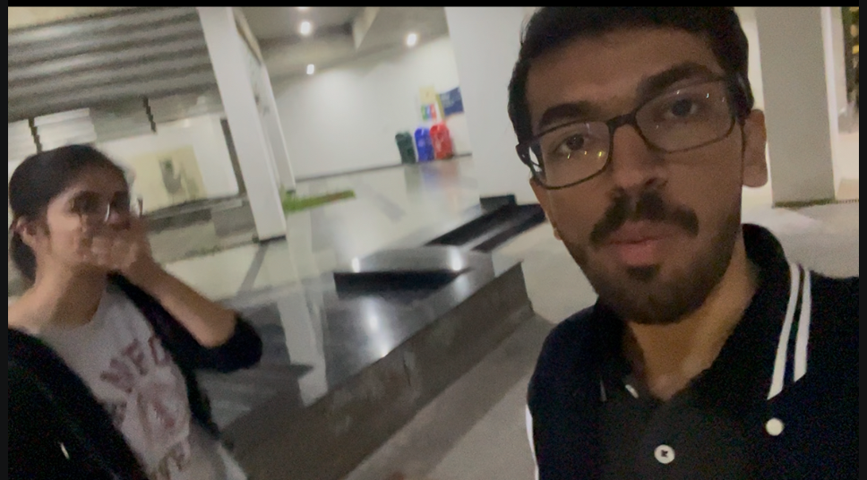
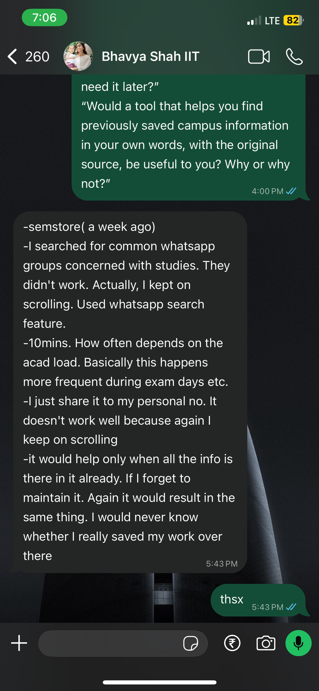

# Campus Recall

**Team:** Raj Modi, Chaitanya, Nakshatra — IIT Gandhinagar  
**Course:** CS437 Vibe Coding Hackathon, 2026–27, Semester 1

## Our user

### Suhani

- **Who:** Suhani, a third-year BTech student at IITGN and Raj's friend and classmate.
- **When/how:** Raj interviewed her in person near Acadamic Block 1 on 7 October 2026.
- **They said:**
  - “i started looking for it in multiple whatsapp grps.”
  - “not that often but it cost some time and i barely missed the registration.”
  - “i usually star the particular message or information on whatsapp and it’s convenient to look for it but when ur in a hurry..it kinda gets annoying to look for it.”
- **Changed:** Our initial plan focused on PDFs. Her experience with a photographed banner led us to include photos and screenshots, using local OCR to extract their text and create searchable embeddings. The app should retrieve the original image without requiring her to remember its filename or WhatsApp chat.
- **Evidence:** [U01: interview notes and responses](docs/user/U01.md). Suhani agreed to inclusion in the project documentation. Here is a selfie after the interview with Suhani

### Bhavya Shah

- **Who:** Bhavya Shah, a third-year Chemical Engineering student at IITGN and Raj's friend.
- **When/how:** She responded over WhatsApp on 9 October 2026.
- **They said:**
  - “I just share it to my personal no. It doesn't work well because again I keep on scrolling”
  - “it would help only when all the info is there in it already.”
  - “I would never know whether I really saved my work over there”
- **Changed:** Add a clear “Saved locally” confirmation after successful storage and a recent-saves view. Keep storage confirmation separate from indexing status so she can see what was saved even while it is processing. These changes address uncertainty about saving; students still need to import the information they want to retrieve.
- **Evidence:** [U02: WhatsApp interview responses](docs/user/U02.md). Bhavya agreed to inclusion in the project documentation. Here is the screenshot of her chat 

### 1. Who, exactly?

Suhani and Bhavya Shah are our specific users. Our intended users are IITGN students who save academic or campus information in photos, screenshots, documents, notes, links, and chats, then remember its topic but struggle to find the original. Suhani's experience concerns an event photo; Bhavya's concerns academic information and uncertainty about maintaining a separate saved-information library.

### 2. The last time

Suhani saw a badminton-team tryouts banner, photographed it, and shared it with someone on WhatsApp. Later, she forgot which chat contained it and searched multiple WhatsApp groups. She remembered the event but not where she had saved its details.

Bhavya described a recent incident as “semstore( a week ago)”. She searched study-related WhatsApp groups, scrolled through messages, and tried WhatsApp search. The meaning of “semstore” and whether she ultimately recovered the information have not been clarified. 

### 3. What it costs them

Suhani reported time lost and said she “barely missed the registration.” Her account connects difficulty finding the announcement with the badminton registration deadline; the precise registration outcome remains unclear. 

Bhavya reported spending approximately 10 minutes looking. She said this happens more frequently when academic load increases, especially during exams, when that time is particularly valuable.

### 4. What already exists

**WhatsApp is the existing alternative for both students.** Suhani stars important messages, while Bhavya forwards information to her own number. These methods help retain information, but both still described scrolling or checking chats to locate it. WhatsApp's standard chat search is keyword-based rather than semantic: it searches for entered words instead of matching the meaning of a remembered description. It offers media/document filters, but its documented workflow does not provide semantic retrieval across the extracted contents of saved images and PDFs. Remembering the topic without the original wording can therefore make lookup difficult. 

Our solutions aims to address this by extracting text from deliberately imported photos, screenshots, PDFs, notes, and saved webpages and searching their meaning in one local library. Students can describe what they remember and open the matching original. It cannot recover a WhatsApp message or file that was never imported.

Our market research also found products that solve parts of this problem:

| Existing product | What it solves | Limitation for our use case | How Campus Recall aims to address it |
| --- | --- | --- | --- |
| **Pixel Screenshots** | Finds saved screenshots using natural-language search. | Its documented retrieval workflow focuses on screenshots, and availability is restricted to supported Pixel phones with an eligible Google Account. It does not establish a general PDF/notes/webpage library. | Search supported images, PDFs, notes, and webpage snapshots together, without an account. Target students' Android phones beyond the supported Pixel range, with compatibility verified during testing. |
| **Siftlee** | Captures mixed content on iPhone, organizes it, and retrieves information with source references. | Its privacy policy allows submitted content and metadata to be processed by its service and third-party AI providers; this does not meet our requirement for entirely on-phone retrieval. | Run OCR, embedding creation, query matching, and original-file retrieval locally, with free core search and no cloud AI service or API key. |

### 5. Who has to say yes?

We dont need any permissions from any admistrative organisation from IITGN as we are for the students by the students

### 6. Where it grows

Three possible extensions, proposed by the team rather than requested by either respondent:

1. Handwriting recognition beyond the printed English OCR baseline.
2. Search for environmental sounds or music beyond speech transcripts.
3. User-controlled encrypted library export/restore.

Visual image search, bounded audio/video search, and unencrypted manual transfer are now part of the planned v1 scope. These are team decisions, not additional requests attributed to either interviewee.

Based on the interviews and our team discussion, we define the problem as follows:

**Problem statement:** IITGN students can remember what saved academic or campus information was about but struggle to locate its original among chats and files. Searching and scrolling take time when the information is needed quickly. A useful personal retrieval tool must let them search from remembered meaning, return the original source, and make successful saving visible.

## Product scope and implementation status

Campus Recall will be a free, installable PWA for iPhone, Android, and laptops. A student saves supported originals, searches remembered meaning or visual appearance, and opens the corresponding original image, PDF page, note, snapshot, or media interval. Every device has a separate local library with manual transfer.

**Status:** The planning PR and both teammate packages are merged. Raj’s implementation on `raj_final` adds the local processing engine, retrieval, interface and PWA. Automated checks and actual-model regression tests pass in the documented Chromium environment. Physical-phone, Safari, installed-PWA and team policy reviews remain outstanding. See [verification evidence](docs/verification/README.md) for results and limits; this specification defines the required behavior, not a blanket completion claim.

Supported inputs: JPEG/PNG/WebP up to 20 MB; unencrypted PDFs up to 20 MB and 50 pages; notes up to 20,000 characters; public webpage text snapshots up to 20,000 characters; MP3/WAV/M4A audio up to five minutes and 50 MB; H.264 MP4 video with optional AAC up to two minutes and 100 MB. MB means 1,000,000 bytes; character limits count Unicode code points. HEIC/HEVC/MOV are outside v1. Unsupported/deep-validation failures have a reason and conversion guidance; already saved originals remain available.

Web capture uses a direct public fetch where browser rules permit; otherwise it offers pasted text or an imported inert HTML/PDF snapshot. There is no proxy or account integration. English is the acceptance baseline. There are no generated answers, reminders, tasks, accounts, or automatic sync.

Browser retention is best-effort. The app requests persistence where available and provides manual backups; it cannot guarantee at-rest encryption or control browser/OS backup policies. Core operations work offline after explicit asset setup. Foreground processing resumes safely after reopening.

## Local AI retrieval and what our code controls

A local embedding model creates vectors for extracted text, images, sampled video frames, and queries. OCR and a local speech model supply text and timestamps. Code compares normalized vectors using cosine similarity, filters weak candidates, groups results by original, and displays excerpts/previews with source references. **No external AI API, hosted embeddings, or cloud inference are used.** This is retrieval, without generated answers.

AI-related tests check source IDs, pages/timestamps, excerpt provenance, filtering, actual retrieval outcomes, and local execution. They do not require exact generated wording. Visual matches need no invented text caption. OCR and transcripts are labelled automated extraction.

Similarity is not a probability of correctness. Calibrate separate text/visual thresholds on separate data, then freeze model revisions, processing, thresholds, and acceptance fixtures. A rejected match means no sufficiently relevant result; it does not prove the user never saved the item.

Model/runtime setup is explicit and may require internet. Afterwards, local-file import, processing, search, restart, and original viewing make no outgoing network requests. User-selected webpage fetch/open and setup are separate actions and never attach unrelated library content or queries.

## Fifteen independently testable specification statements

Each statement needs its own automated test using a fresh library/fixtures. The [acceptance design](docs/implementation/acceptance.md) defines the planned corpus, negatives, calibration, device evidence, and test boundaries. Executable tests and fixtures are now implemented. Read [verification evidence](docs/verification/README.md) for current results and unperformed physical-device checks; this specification defines required behavior rather than asserting completion.

### S1 — Durable local save

**Statement:** Saving a supported file, note, or webpage snapshot without a mandatory title/tag stores its original and metadata before showing “Saved locally”. It remains in recent saves after restart, including when models are not installed.

**Test:** Independently save each supported kind, restart the database/browser profile, and compare original bytes/hashes, note/snapshot text, IDs, and URLs. Force a transaction/storage failure and assert no successful item or confirmation. A saved original with later processing failure remains browsable.

**Trace:** From Suhani's interview about saving a banner photo and Bhavya's interview about knowing whether information was saved.

### S2 — Browse, filter, and rename

**Statement:** The library lists items newest first, filters by kind/status, and permits display-title changes while preserving item identity, capture time, and original bytes.

**Test:** Seed a fresh mixed-status/type library with duplicate titles and known timestamps. Check stable recent ordering, filter combinations, and rename without changed IDs/hashes. Renaming must not cause one item's viewer to open another original.

**Trace:** From Bhavya's interview about scrolling and uncertainty about maintaining the library.

### S3 — Delete without resurrection

**Statement:** Deleting an item removes its original, derived content, previews, and jobs. An interrupted or late processing response must never recreate that item or its index.

**Test:** Independently delete queued, Ready, and Processing fixtures. Release a delayed processing publication after deletion and assert it is rejected. Repeat deletion and inspect all related stores; no original/result may reappear after restart.

**Trace:** From our team's privacy and reliable local-storage requirements, informed by market research.

### S4 — Safe webpage capture and fallback

**Statement:** A student can capture a permitted public webpage or save its URL with manually supplied text/inert HTML/PDF content when direct extraction fails. Captured HTML must never execute, and a URL-only entry must not pretend to contain extracted page contents.

**Test:** Use controlled allowed/blocked-fetch fixtures, manual text, and an HTML fixture containing scripts/event handlers. Verify stored URL/text and no script execution; failures expose the fallback. Check text limits and visible truncation rather than an unannounced full-page claim.

**Trace:** From our market research and team decision to support saved links without a server or account integrations.

### S5 — Exact original and source location

**Statement:** Selecting a result opens its saved original by item ID, at the mapped PDF page or media interval when applicable. Text excerpts come from that source's extracted segment. The app must never fabricate a reference or substitute another original when the source is unavailable.

**Test:** Seed independently mapped image/PDF/note/snapshot/audio/video sources with duplicate titles. Check IDs, original bytes/text, excerpt membership, PDF page, and annotated media interval with two-second edge tolerance. Remove one original and assert an unavailable state without substitution.

**Trace:** From Suhani's interview about recovering the original saved photo, with source verification added by our team.

### S6 — Manual library transfer

**Statement:** A selected-item export and valid restore preserve original bytes, titles, capture times, and source URLs. New restored items are queued for local indexing; content duplicates are reported without overwriting existing originals.

**Test:** Export a fresh mixed library and restore into a second browser profile. Compare hashes/metadata and queued status. Test identical titles with different content, a true hashed duplicate, invalid version/path/hash, missing files, and a forced import failure. Invalid import must leave the previous library unchanged. No embeddings or model weights belong in the archive.

**Trace:** From our team's decision to support separate private device libraries with manual transfer.

### S7 — Honest model setup and offline readiness

**Statement:** Explicit setup reports real asset progress and declares Offline ready only after every required model, tokenizer, OCR, PDF, media, and WASM asset is cached and verified. Incomplete assets require repair rather than a remote inference fallback.

**Test:** Interrupt setup, remove/corrupt a required runtime asset, resume, and inspect readiness. With complete verified assets, restart offline and run actual small-file processing/search. Missing assets must not produce a false readiness or silent remote call.

**Trace:** From our market research and team requirement for free local inference without API keys.

### S8 — Local OCR and PDF extraction

**Statement:** Supported readable images and PDFs produce locally extracted text and embeddings with correct PDF page provenance. Failed/corrupt/unsupported processing preserves the saved original with Failed status and a reason rather than Ready.

**Test:** With networking disabled after setup, process known-phrase JPEG/PNG/WebP, text PDF page 2, and scanned PDF fixtures using actual OCR and embeddings. Each agreed small fixture must become Ready within the 120-second reference-phone target. Check page mapping plus corrupt/encrypted/over-limit failures. This is a target, not measured speed.

**Trace:** From Suhani's interview about information inside a photographed banner; PDF and offline limits are team scope decisions.

### S9 — Semantic retrieval and weak-match rejection

**Statement:** In the frozen 30-item corpus, every text query R1–R6 returns its expected original among the top three distinct items, including the paraphrase without meaningful shared words. The fixed unrelated queries return no relevant result; duplicate chunks cannot occupy separate item-result slots.

**Test:** Independently build the corpus through actual extraction/embedding and search offline with frozen thresholds/configuration. Assert expected IDs and empty negative results. Separately use controlled scores to check below/at/above-threshold filtering, deterministic grouping, and tie-breaking. Do not assert exact empty-state wording or use mocked ranking as retrieval evidence.

**Trace:** From Suhani's and Bhavya's interviews about difficulty finding saved information, with weak-match rejection added by our team.

### S10 — Visual image and video-scene search

**Statement:** The fixed visual queries R7/R8/R12 retrieve their expected original image or sampled video scene among the top three, without depending on answer words in filenames, OCR, or metadata.

**Test:** Build a fresh visual fixture library with actual image embeddings, no descriptive answer metadata, and the frozen queries. Check original IDs and video sample locations. Show previews/locations rather than a generated caption. Only scenes visible at the agreed sample times are guaranteed by these cases.

**Trace:** From our market research and team decision to extend retrieval beyond OCR text.

### S11 — Speech and timestamp retrieval

**Statement:** English speech in supported audio/video becomes searchable, and R9/R10/R11 retrieve their original media among the top three with a location covering the relevant spoken interval. Silent video remains eligible for visual indexing.

**Test:** Independently process actual short audio/video fixtures and run speech queries without answer-bearing filenames/metadata. Check source IDs, required speech content, and independently annotated intervals with two-second edge tolerance. Check near-silence, silent video, duration/codec limits, and explicit failures. Do not compare the complete transcript to exact generated wording.

**Trace:** From our team's selected multimodal scope, informed by market research; this was not requested by either interviewee.

### S12 — Recoverable processing and retry

**Statement:** Interrupted or failed processing preserves the original and exposes its state. Reopening/retrying completes a valid current generation without duplicate published segments or stale-claim writes.

**Test:** In a fresh library, interrupt actual processing before publication, reopen, and retry. Inject a recoverable extraction failure, observe Failed, retry, and check one complete Ready generation. Attempt stale-generation publication and verify it does not alter the item.

**Trace:** From Bhavya's interview about knowing what was saved, with processing recovery added by our team.

### S13 — Responsive installable offline PWA

**Statement:** The app supports the agreed phone/laptop layouts and installation paths. After its assets are cached, its interface, policy pages, and saved originals can reopen offline without hiding files behind model setup.

**Test:** Use a production build at 390/768/1440 px; verify navigation, long filenames, empty/errors, focus, keyboard, and reduced motion. Reload the cached shell and originals offline in the same profile. Record physical-phone installation, keyboard-open, safe-area, zoom, and playback checks separately from emulation.

**Trace:** From our team's decision to make the local product usable on iPhone, Android, and laptops.

### S14 — Never upload private content for processing

**Statement:** Core import, extraction, embedding creation, search, restart, and saved-source viewing must never send originals, extracted content, embeddings, source metadata, or queries to remote storage, analytics, or AI services. These paths work offline after setup.

**Test:** With assets ready, exercise all supported modalities using fresh sentinel-bearing private fixtures and monitor actual outgoing requests. Assert no core-path egress or remote sentinel leakage. Test setup and explicit webpage requests separately; they must not attach unrelated content/queries. Missing assets cause repair rather than remote inference. Do not claim control over OS/browser backups.

**Trace:** From our market research on cloud-processing limitations and our team's private local-retrieval decision.

### S15 — Accessible and truthful policy pages

**Statement:** Privacy Policy and Terms and Conditions are linked from Settings and first-use information, work before models are installed, reload directly, and remain accessible offline after app caching. Their descriptions match actual implemented storage/network behavior and do not invent institutional endorsement or security guarantees.

**Test:** In a fresh browser profile, navigate to both hash routes before setup, then cache/reload offline from a production build. Check links and readable headings. Review text against actual destinations, storage, export/delete behavior, and project contact information. Apply the UI copy/style checklist, with physical-device review recorded separately. Policy text alone never proves privacy behavior.

**Trace:** From our team's product-transparency requirements and the agreed UI instructions.
