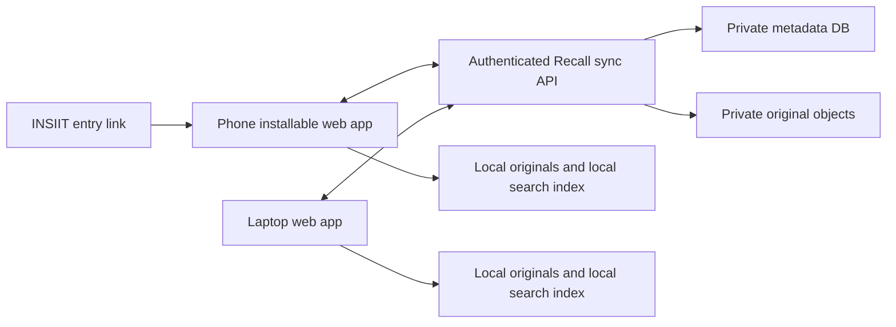

# Campus Recall: INSIIT, Azure and optional sync options

Date: 4 November 2026, Asia/Kolkata. Status: researched proposal, awaiting decisions. No implementation or deployment is authorized by this document.

## Recommendation and confirmed requirement

Keep Campus Recall as an installable web app (PWA) for phones and laptops. Add a separate, optional account-sync service while keeping extraction, embeddings and search on each device. Use the agreed INSIIT relationship for an entry point, server hosting and identity integration, with Recall operated as an independent service. Keep Azure as a time-boxed fallback so the demo does not depend on server setup or an INSIIT mobile release.

**Raj confirmed that phone–laptop sync must work for the 17 November demo.** Hosting alone is therefore insufficient. The earlier GitHub Pages-first recommendation is superseded; no host has been selected yet.

**Raj reports that INSIIT maintainers have agreed to collaborate and can provide a server.** They can distribute a downloadable executable or link to Recall's independent website, and offer authenticated entry from INSIIT. Direct visitors would authenticate for account access. Server access/capacity, identity configuration and domain details are not yet supplied. The partnership is user-confirmed; infrastructure readiness is not independently verified.

**Raj chose to include getting an instructor exception before merging sync.** The ordinary-versus-end-to-end-encrypted sync decision is still pending. This proposal compares both privacy designs instead of assuming either has been approved.

The existing S1–S15 baseline at main `45cbcfb` is complete: exact-main CI107fast/37browser/11actual-model/all15statements passed. The new account/sync feature is proposed work, with its own specification, tests and review; the old green result is not evidence that sync already exists.

## What the INSIIT repositories establish

Source snapshots read on4November:

| Repository                                                                                                                             | Inspected revision                         | Observed facts                                                                                                                                                                       |
| -------------------------------------------------------------------------------------------------------------------------------------- | ------------------------------------------ | ------------------------------------------------------------------------------------------------------------------------------------------------------------------------------------ |
| [insiit-ui-react-native](https://github.com/Metis-IITGandhinagar/insiit-ui-react-native/tree/ef3d1830f40ce9d53f0058ce293a8672be416348) | `ef3d1830f40ce9d53f0058ce293a8672be416348` | React Native/Expo57; Firebase+Google sign-in; IITGN email restriction in client; bearer Firebase ID tokens on API calls. README identifies Android as supported and iOS as untested. |
| [insiit-backend-rust](https://github.com/Metis-IITGandhinagar/insiit-backend-rust/tree/c57b893897e4e8a32f78709a0f1a5981450201a4)       | `c57b893897e4e8a32f78709a0f1a5981450201a4` | Axum/Tokio Rust service, PostgreSQL/sqlx, Firebase token verification. Compose defines app+Postgres16 with a persistent DB volume.                                                   |

Important implementation evidence:

- [UI authentication](https://github.com/Metis-IITGandhinagar/insiit-ui-react-native/blob/ef3d1830f40ce9d53f0058ce293a8672be416348/src/core/auth/authService.ts) and [API client](https://github.com/Metis-IITGandhinagar/insiit-ui-react-native/blob/ef3d1830f40ce9d53f0058ce293a8672be416348/src/core/api/apiClient.ts) show a compatible identity direction. They do not grant access to the Metis Firebase project or automatically log an external browser into the native app's session.
- [OTA documentation](https://github.com/Metis-IITGandhinagar/insiit-ui-react-native/blob/ef3d1830f40ce9d53f0058ce293a8672be416348/docs/ota-updates.md) describes a VPS/nginx static update host. The code does not establish current backend topology, spare RAM/disk/bandwidth, backups or deployment rights. Collaboration/server availability is separately reported by Raj above.
- The backend [Dockerfile](https://github.com/Metis-IITGandhinagar/insiit-backend-rust/blob/c57b893897e4e8a32f78709a0f1a5981450201a4/Dockerfile) uses `cargo watch`; Compose bind-mounts source. Treat these as development configuration, not a production recipe to copy unchanged.
- Backend [main.rs](https://github.com/Metis-IITGandhinagar/insiit-backend-rust/blob/c57b893897e4e8a32f78709a0f1a5981450201a4/src/main.rs) publicly serves an image directory and uses permissive CORS. Private Recall originals need a separate authenticated storage path and stricter browser-origin handling; do not upload them into the existing public image directory.
- The UI declares `expo-linking` and `expo-web-browser`; it does not declare `react-native-webview` in the inspected package file. A browser launch integration is a plausible small contribution, subject to review. A WebView/native feature is additional integration work.
- UI is MIT-licensed. No backend README/license file appeared in the inspected tree; ask maintainers about reuse terms before copying backend implementation. This plan only reads their source.

## Client options: website or app?

| Option                                            | Phone/laptop experience                                                            | Work and trade-off                                                                                                                                                                                                                                                           | Decision                                                                      |
| ------------------------------------------------- | ---------------------------------------------------------------------------------- | ---------------------------------------------------------------------------------------------------------------------------------------------------------------------------------------------------------------------------------------------------------------------------- | ----------------------------------------------------------------------------- |
| Installable PWA plus INSIIT entry link            | Same app on iPhone, Android and laptop; installation remains optional              | Reuses the verified browser engine, IndexedDB and service worker. INSIIT can open the stable HTTPS URL in the system browser.                                                                                                                                                | Recommended for demo and initial users.                                       |
| PWA inside an INSIIT WebView                      | Looks embedded in the campus app; laptop still needs web client                    | New browser/storage context. Must independently validate workers, WASM/GPU, downloads, picker, playback, persistence, sign-in and lifecycle. Existing Safari/Chrome passes do not establish WebView compatibility.                                                           | Technical spike later; do not make demo depend on it.                         |
| Downloadable desktop executable or mobile wrapper | INSIIT can distribute a release/download link; each platform needs its own package | A desktop Electron/Tauri-style wrapper can reuse some web code, but still needs storage/runtime validation, platform builds, signing and updates. A Windows executable does not serve iPhone/Android/macOS. Sync still needs a backend if users want cross-device libraries. | Consider after the web+sync pilot; no executable is built by the current app. |
| Full React Native Recall screens in INSIIT        | Stronger native capture/share integration; still need laptop web client            | DOM UI, IndexedDB, browser workers, OCR/PDF/media runtimes and model execution need native adapters or replacements. Reusing React does not make this a drop-in screen. Mobile distribution and maintenance also expand.                                                     | Longer-term option after adoption.                                            |

A PWA is an app delivered through the web. It can have a home-screen icon and offline functionality without maintaining a separate native implementation. Native work is justified later if students need share-sheet ingestion, capture or background processing that the tested web path cannot provide.

Start the INSIIT integration with a launcher link and joint pilot. Identity handoff, cohosting, shared-content capture and native embedding are distinct increments. Do not inject private library data into general INSIIT search or analytics. Any later “save announcement to Recall” action must be user initiated and honor its source permissions.

## Hosting options, independent of the client choice

| Host                                                 | Proposed deployment                                                                                                                                            | Benefits                                                                                           | Preconditions/costs                                                                                                                                                                                                                                                                                |
| ---------------------------------------------------- | -------------------------------------------------------------------------------------------------------------------------------------------------------------- | -------------------------------------------------------------------------------------------------- | -------------------------------------------------------------------------------------------------------------------------------------------------------------------------------------------------------------------------------------------------------------------------------------------------- |
| INSIIT/Metis infrastructure                          | Isolated Recall web/API container, dedicated DB/role, private object storage or durable private file volume, existing reverse proxy                            | Campus ownership and ongoing distribution; can share operational knowledge and an identity project | Maintainer agreement, capacity, stable hostname, least-privilege deploy access, backup/restore owner, quotas and ongoing funding. Do not change INSIIT's production data or credentials.                                                                                                           |
| Azure Linux VM                                       | Portable Docker Compose deployment: web/proxy, sync API, Postgres on managed persistent disk; private Blob Storage or private file volume with off-host backup | Closely resembles a VPS/container deployment and is easier to move to Metis                        | VM patching/TLS/backups are our responsibility. Pick region/SKU after checking the student subscription and actual prices. One host is not high availability.                                                                                                                                      |
| Azure Container Apps                                 | Web/API container with HTTPS ingress; durable managed metadata DB and private Blob Storage outside the container                                               | Managed ingress/revisions; compute can scale down between use                                      | Database, logs, registry, storage and transfer have separate costs. Never keep the only DB/files in the container filesystem; single replica does not make it persistent.                                                                                                                          |
| Azure Static Web Apps plus separate sync API/storage | Managed static frontend, independent backend                                                                                                                   | Potentially inexpensive frontend hosting                                                           | Static hosting alone cannot implement sync. Validate the actual32.2MB WASM asset and API transfer limits; documentation lists a30MB request-size limit, whose effect on a particular static asset must be tested rather than assumed. Large originals should use chunked/private object transfers. |

**Host recommendation:** take the offered Metis server if access, capacity, operator and domain can be concretely agreed by6November; otherwise proceed with Azure once authorized. This is a readiness deadline for an agreed collaboration, not a demand for a new partnership decision. Prefer the same portable service boundaries on either host. VM vs Container Apps is an operational choice, not a reason to change the product's privacy contract.

### Domain and continuity

Raj proposes obtaining an independent domain using the GitHub Student Developer Pack/Name.com offer. [GitHub's current listing](https://education.github.com/pack) includes selected extensions, and [Name.com's support documentation](https://www.name.com/de-de/support/articles/360036364834-signing-up-for-github-student-developer-pack) describes eligible registrations as free for the first year. Chosen name availability, redemption eligibility and renewal price remain unchecked. This is not permanent free registration or hosting.

Use one team-approved stable HTTPS origin, such as `app.<chosen-domain>`, for both INSIIT-launched and direct entry. The example is not a registered/available-name claim. Prefer same-origin `/api` behind the reverse proxy for the first deployment. Keep that hostname across Metis/Azure moves; change DNS/infrastructure while retaining the origin, identity mapping and data, rather than asking students to recreate their browser library. Assign domain/DNS/renewal ownership for after graduation. No domain purchase or DNS change is authorized here.

The Azure screenshot shows $100 of $100 available and365days remaining at capture; this is not a live subscription inspection or a guarantee that a particular region/SKU is available. Use the credit for hosting/storage, not cloud AI: the retrieval models continue running on clients.

Before provisioning, estimate the whole pilot in the chosen region. A proposed budget target is no more than $25 of the credit through demo day, retaining the remainder; this is a spending target, not a price quote. Set cost alerts where supported, verify the student credit spending limit, cap replicas/quotas/log retention, and track daily usage. Azure budget alerts do not automatically stop resources. Check actual subscription limits and avoid adding Kubernetes/GPU/managed services without a demonstrated need.

## Privacy options

| Mode                               | What leaves the device                                                                           | Who can read content                                                                                           | Complexity                                                                                                               |
| ---------------------------------- | ------------------------------------------------------------------------------------------------ | -------------------------------------------------------------------------------------------------------------- | ------------------------------------------------------------------------------------------------------------------------ |
| Local-only, default                | Ordinary app/model downloads and explicit external page actions; no library/sync traffic         | Existing local browser-profile access rules                                                                    | Preserve the current verified mode; no mandatory account.                                                                |
| Optional ordinary account sync     | Explicitly selected library originals and metadata over HTTPS                                    | Authorized backend/operator can technically access plaintext; provider at-rest encryption does not change that | Fastest reliable demo scope, if Raj accepts this trust model.                                                            |
| Optional end-to-end encrypted sync | Client-encrypted originals and private metadata, plus necessary routing/size/account information | Possession of the vault key is needed to decrypt stored objects                                                | Stronger stored-data privacy, but adds pairing/recovery, key lifecycle, authenticated encryption and cross-device tests. |

Even with cloud sync enabled, keep search queries, embeddings, OCR/transcripts and derived previews local. Sync supported originals/metadata, then reindex independently on each device. A newly received original can open before its search index becomes Ready. Each device still needs model setup; syncing files does not transfer the445MB model cache.

For the17November deadline, implement **local-only plus one chosen sync design**, not three configurable security products. If ordinary sync is accepted, label its operator-access model plainly. If E2EE is required, design it from the first upload and cut optional native/automation scope; do not upload plaintext first while promising future encryption.

For E2EE: use a reviewed envelope format and standard authenticated encryption via a maintained implementation/Web Crypto, unique nonces, authenticated object identity/version/chunk ordering, and a random per-vault secret. Encrypt titles/URLs/plaintext hashes too if hiding them is part of the claim. Verify decrypted bytes against the encrypted manifest before publishing them locally. Do not derive an encryption key from an email address or an ID token. An initial explicit recovery-code or trusted-device transfer flow is smaller than inventing password recovery. Google sign-in establishes identity, not possession of the decryption key. Explain that losing all keys can lose cloud recovery, and that a web-delivered client still trusts its code/update supply chain; do not claim absolute protection against a malicious app update.

Required consent/lifecycle behavior:

- Signing in does not silently upload the existing library. Show what will be synchronized and its approximate size; require explicit opt-in.
- Local-only must not initialize auth/sync requests in the background. This does not mean opening a hosted app or downloading models is anonymous or network-free.
- “Pause sync” stops new transfers/listening/polling and cancels queued/in-flight work as far as possible. It cannot undo bytes already sent; show completion/failure honestly.
- “Disconnect and remove cloud copy” is a separate authenticated operation. Preserve desired local originals, remove live remote objects/metadata, revoke devices, and state backup-retention behavior. Offline copies on another device cannot be remotely guaranteed erased.
- Distinguish local save, indexing and sync state: Saved locally / Upload pending / Synced / Indexing / Sync error. Never relabel a local save as cloud-durable before acknowledgement.
- Switching account must stop the previous sync/worker session and prevent late responses from entering the next user's library. Use separate account libraries; offer an explicit copy/import from the existing anonymous library rather than silently claiming it.

## Account and INSIIT integration contract

Preferred with the agreed maintainers: register a web client in the same Firebase project and validate tokens for that exact issuer/audience in the separate Recall API. Confirm authorized web domains, public client configuration and the identity support owner. Key ownership by stable provider/project+subject, not a client-supplied email. Validate signature, lifetime, audience/issuer, verified email and allowed IITGN domain on the server; the native client's email check is insufficient for a new API. Anonymous INSIIT sessions do not receive personal-vault access.

The requested entry paths are:

1. **From INSIIT:** use the existing valid Firebase ID token on an authenticated backchannel to request a short-lived, one-use, Recall-scoped login handoff. The browser exchanges the opaque code for its own session. Bind the flow to the expected browser state and an appropriate PKCE/proof-of-possession challenge; allowlist the exact callback and reject replay/expired/wrong-target codes. A web-initiated round trip through the native app may be needed to establish browser state/challenge; spike and test it rather than inventing an unbound token relay. Never put a reusable Firebase bearer token in a URL, public page or logs, or pass an encryption key as part of SSO.
2. **Direct website/PWA entry:** offer verified IITGN Google sign-in, producing the same identity as the INSIIT route. No INSIIT installation is required. Authentication is required for a synced account; recommended local-only guest use remains available without account sign-in, subject to Raj's UI choice.

Native Firebase session storage does not automatically transfer to the PWA. The agreed handoff is an implementation task, not an existing source capability. Start the first vertical slice with direct web sign-in, then add and verify the agreed seamless entry before promising it. If the handoff is not ready, INSIIT can launch the same website and the user signs in there using the same IITGN identity.

If the Metis identity project is unavailable by the decision deadline, use our own explicitly configured Google/Firebase web identity for the pilot. That provides one Recall account across devices, not existing INSIIT SSO. Later linking/migration must be explicit and verified; equal email strings from different identity projects are not a complete account-migration design.

## Minimum working sync design

First demo acceptance slice: PDFs, images, notes and saved webpage text between an actual phone and laptop. Local audio/video remain available. Whether cloud sync also covers audio/video is an explicit scope decision; do not claim it from an arbitrary-file API without the corresponding100MB/playback tests. All six local input kinds remain supported.

The API/storage may live beside INSIIT or on Azure. E2EE, if chosen, encrypts before objects/metadata leave either client. No server inference or vector database is needed.

- Introduce a separate global sync ID and revision mapped to a device-local item ID. Do not repurpose the existing manual ZIP restore path: S6 intentionally creates new local IDs and skips duplicates; it has no rename/delete replication log.
- Save locally and enqueue a sync operation atomically in IndexedDB. A foreground outbox retries on reopen/online; upload failure must not roll back a successful local save. Persist pull cursors with applied local changes in the same transaction.
- The server uses owner-scoped rows, immutable original versions, server-controlled revisions/change cursors and idempotent operation IDs. Do not order conflicting changes by phone clocks. Keep originals immutable for this slice; rename/delete are the mutable operations.
- Upload in bounded chunks or directly to a private object store through short-lived, object-scoped grants. Verify owner, total size/quota and completed object before making it visible in the change log. Incomplete uploads have expiry/garbage collection; never publish a broken original reference.
- Retry must not create duplicate items. Preserve two distinct saved items even if their bytes match. Any byte-level deduplication is owner scoped and separate from item identity; avoid exposing cross-user content-existence checks.
- Use expected revisions to detect concurrent renames. Preserve conflicting changes for resolution instead of silently overwriting. Delete must create a durable tombstone that rejects stale upload/rename replay and prevents resurrection. Keep tombstones for the pilot or force full reconciliation for clients older than retention.
- Synced originals are verified and committed locally, then queued for the existing local indexer. Processing generation/claims/status and derived segments are device-local. Reuse the existing rejection of stale processing responses.
- Foreground sync on launch, visibility/online changes and explicit Sync now is enough initially. Define a measured foreground propagation target in tests; do not promise iOS background or screen-off synchronization.
- Start with a small invite-only pilot and explicit document/storage quotas, proposed200MB/account for the four-kind sync slice and the existing per-file limits. Values need agreement and actual capacity validation.

Implementation language choice: a TypeScript/Node24 API minimizes new-language overhead for the current team; Rust/Axum is sensible if Metis agrees to own its maintenance. A separately hosted container can use either language. Agree on the HTTP/storage contract before implementation; cohosting does not require copying or merging into INSIIT's backend.

Production packaging needs a pinned build/runtime, health checks, non-root service, persistent data, restricted network/storage credentials, strict CORS and no-store private API responses. Keep private documents out of public static paths and the PWA asset cache. Keep logs free of document bodies, titles/queries, bearer tokens and signed object URLs. Configure framework/proxy body limits for the actual transfer protocol. On Azure, Blob Storage is accessed through its API; Container Apps does not mount Blob as a durable local filesystem.

## Course specification decision

The [Class20 page](https://anup.github.io/courses/cs437-2026-27-sem1/classes/class-20/) says the completed spec is frozen. Current S14 explicitly forbids originals/metadata going to remote storage; the product direction also excludes accounts/automatic sync. S6 describes manual transfer, and S15 requires truthful policies. An optional sync extension cannot silently inherit the existing no-egress promise.

Raj confirmed that getting an instructor exception belongs in this plan. Obtain an approved extension scope before merging sync into the graded baseline. Preserve the passing v1 revision and original tests. On an approved extension branch, add tests first for explicit local-only behavior plus the new opt-in sync contract and truthful policies. Do not delete/weaken S14 tests or merely rename a failed old promise. Until resolved, the sync plan remains a proposed extension, not completed coursework or permission to merge.

## Proposed schedule and review checkpoints

Dates are targets dependent on decisions/review, not completion claims.

| Date      | Deliverable/gate                                                                                                                                                                                                                                     |
| --------- | ---------------------------------------------------------------------------------------------------------------------------------------------------------------------------------------------------------------------------------------------------- |
| 4–5 Nov   | Agree sync privacy/scope, obtain instructor exception, and get practical access details from the agreed maintainers; choose stable origin and auth ownership. Preserve current passing baseline. Write failing sync/auth/privacy acceptance tests.   |
| By6Nov    | Confirm Metis hosting or select Azure fallback. Preflight real quota, region, complete cost and durable storage. Agree API/identity/object contract.                                                                                                 |
| 6–8 Nov   | First vertical slice: opt-in, direct login on phone+laptop, save useful PDF on phone, receive exact bytes/metadata on laptop, local indexing and natural-language search/page opening. Spike and implement INSIIT handoff against the same identity. |
| 9–11 Nov  | Foreground offline outbox/retries, atomic publication, rename conflicts, tombstones/delete, account isolation, disable/delete-cloud behavior. E2EE pairing/integrity if chosen.                                                                      |
| 12–14 Nov | Independent review and full regression, hosted iPhone/Android/laptop sync tests, restart/backup restore, real pilot users/feedback. Decide scope cuts if reliability gates fail.                                                                     |
| 15 Nov    | Release candidate/demo rehearsal; stable origin, known-good backups and rollback, model caches prepared, publish only through authorized reviewed release.                                                                                           |
| 16 Nov    | Reserve time for the course's unseen feature/acceptance exercise. Avoid scheduling initial sync integration here.                                                                                                                                    |
| 17 Nov    | Demonstrate real two-device sync, local retrieval and privacy controls; report actual users and current limits.                                                                                                                                      |

Suggested ownership, not assignments/messages: Raj owns local repository/outbox/reconciliation and engine integration; Chaitanya owns authenticated API/object storage/deployment and server contract tests; Nakshatra owns account/consent UI, device isolation and two-device/privacy/recovery acceptance (plus client key UX if selected). Agree contracts together first. Use coherent tested checkpoint commits and reviewed PRs; no commit quotas or attribution rewriting.

## Acceptance required for the extension

1. UserA phone uploads a selected original; userA laptop receives identical bytes/hash and title/capture/source metadata, indexes locally and retrieves its source/page. A second named account cannot list/read/overwrite/delete it, even with a guessed object/item ID or edited client ownership field.
2. Local-only mode works without sign-in and emits no library/auth/sync request; opt-in is the only path to first upload. Search queries/derived extraction stay local in either mode. Extend monitoring to HTTP/HTTPS/WebSocket as appropriate instead of assuming the old HTTPS-only helper proves every transport.
3. Expired/wrong-project/tampered/anonymous/unverified/wrong-domain credentials fail closed on server; offline local use survives auth/network failure. Account switching discards late requests and isolates local/remote libraries.
4. Interrupted/duplicate uploads, response loss, application/worker reload and backend restart resume without partial visible originals, duplicate item creation or local data loss. Verify storage survives container replacement and an actual backup restore.
5. Two offline clients rename/delete concurrently: no silent overwrite or resurrection. Retry and stale-cursor rejoin cannot restore a tombstoned item. Same-byte/different-item imports retain their identities.
6. Pause stops future transfers; cloud removal removes live server copies according to the documented retention, without deleting chosen local originals. Previously downloaded offline copies and backups have honest limits.
7. If E2EE: object/manifest tampering, wrong key, missing/reordered chunks fail without replacing local data; a paired second device decrypts exact bytes; no vault key/plaintext metadata enters server logs. Test recovery and key-loss behavior.
8. Hosted Chrome/Safari and installed app exercise actual picker, sign-in/return, safe controls, sync status, before-model original opening, offline reopen and service-worker update. New network/auth behavior needs hosted-device checks even though earlier v1 device tests passed.

The existing main CI gates remain required. Add extension server and two-client tests as explicit jobs/evidence; current107/37/11 counts are the old baseline, not fixed expected totals for the extension.

## Pending answers and next action

- Confirmed by Raj: sync must work for demo day; INSIIT maintainers agreed, can provide a server and offer installer distribution or a launch link/authenticated entry; an independent domain is proposed; getting an instructor exception is included.
- Awaiting: actual server/deploy/identity configuration, domain/name/renewal decision, ordinary vs E2EE sync, and the instructor's exception outcome. Collaboration is agreed; usable infrastructure is not yet independently verified.
- Proposed: PWA + isolated sync service, INSIIT launcher/cohosting, safe code-based sign-in handoff and direct Google sign-in, Azure fallback by6November; local-only default; foreground four-kind sync first.

After decisions, write the concrete approved implementation specification and small PR sequence. No resource creation, maintainer outreach, secret transfer, source change, deployment or publication is performed by this planning task.

## Primary references

- [INSIIT client README](https://github.com/Metis-IITGandhinagar/insiit-ui-react-native/blob/ef3d1830f40ce9d53f0058ce293a8672be416348/README.md), [backend auth](https://github.com/Metis-IITGandhinagar/insiit-backend-rust/blob/c57b893897e4e8a32f78709a0f1a5981450201a4/src/auth.rs), [backend Compose](https://github.com/Metis-IITGandhinagar/insiit-backend-rust/blob/c57b893897e4e8a32f78709a0f1a5981450201a4/docker-compose.yaml).
- [Firebase token verification](https://firebase.google.com/docs/auth/admin/verify-id-tokens) and [web Google sign-in](https://firebase.google.com/docs/auth/web/google-signin).
- [Azure Students](https://azure.microsoft.com/en-us/free/students/), [Container Apps overview](https://learn.microsoft.com/en-us/azure/container-apps/overview), [billing/free allocation](https://learn.microsoft.com/en-us/azure/container-apps/billing), [durable storage limits](https://learn.microsoft.com/en-us/azure/container-apps/storage-mounts), [SWA quotas](https://learn.microsoft.com/en-us/azure/static-web-apps/quotas).
- [Azure limited object access](https://learn.microsoft.com/en-us/azure/storage/common/storage-sas-overview), [budgets are alerts, not spending stops](https://learn.microsoft.com/en-us/azure/cost-management-billing/costs/tutorial-acm-create-budgets), [credit spending limits](https://learn.microsoft.com/en-us/azure/cost-management-billing/manage/spending-limit).
- [Class19 deployed usability](https://anup.github.io/courses/cs437-2026-27-sem1/classes/class-19/) and [Class20 spec freeze](https://anup.github.io/courses/cs437-2026-27-sem1/classes/class-20/).
