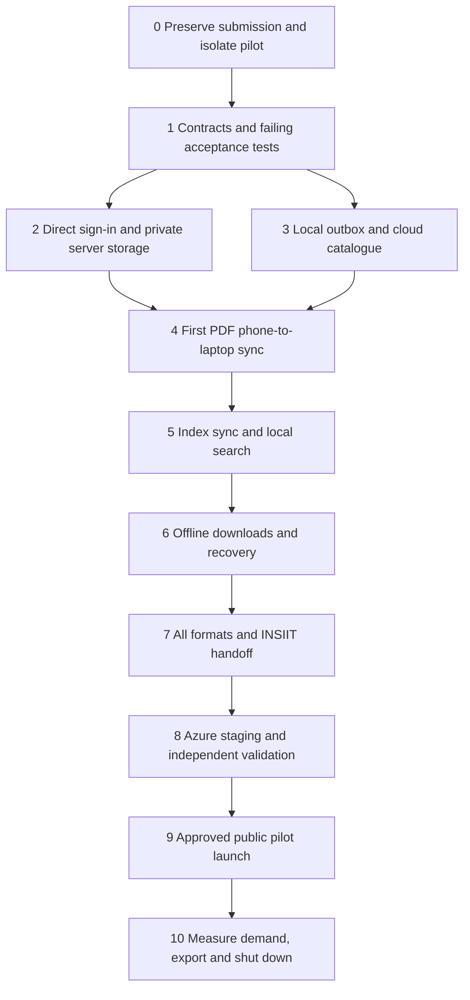

# One-month pilot: implementation order, flows and access

Date: 4 November 2026, Asia/Kolkata. Status: proposed implementation plan. All phases below are not started. This planning request does not authorize implementation, Git publication, cloud provisioning or deployment.

## Decisions on 5 November

- **No Firebase (decided 5 November, later).** The pilot server runs Google sign-in itself (OpenID Connect authorization code flow with PKCE) with a Google OAuth web client; everything else is hosted on Azure. This supersedes the "own Firebase project" wording in the next bullet and every Firebase mention below (stack table, Phases 1, 2, 7 and 8, access list). What Raj supplies instead: a Google Cloud OAuth client ID and secret, with the pilot's callback URL `https://<pilot-host>/api/v1/auth/google/callback` registered on it.
- **Sign-in is Google-based and independent.** The pilot uses its own Firebase project with the Google provider, restricted to verified `@iitgn.ac.in` accounts. It does not depend on the INSIIT/Metis backend, Firebase project or maintainers. INSIIT integration (shared identity, one-use login handoff, maintainer agreement) is future scope; until then an INSIIT link may only open the pilot site, where users sign in directly. This supersedes the INSIIT Firebase choice in the stack table and Phases 2 and 7 below.
- **Work starts now.** Phase 0 and Phase 1 run in an isolated worktree on branch `pilot/auto-sync`, based on `main` at `45cbcfb`. Commit, push, PR, provisioning and deployment each still need their own authorization.
- **Deferred:** Azure region sizing and cost (region India South Central recorded; only `koreacentral`, `malaysiawest`, `eastasia`, `indiasouthcentral` and `indonesiacentral` are allowed by the student subscription's policy, so the Central India figures in the scope note are illustrative only), the lighter-backend alternatives and the team split stay as written for now.
- **Still unknown:** the exact submitted 3 November revision. Phase 0 records it once Raj supplies it; `45cbcfb` is the pilot base, not a claim about what was submitted.

## Agreed product and submission boundary

- Preserve the completed3November submission/form/website, root specification, historical results and original repository main. Develop/deploy the pilot independently; do not reinterpret the old passing local-only baseline as evidence for the new cloud feature.
- Delivery: one installable PWA for phone/laptop, independent domain on Azure, entry link from INSIIT. Keep native binaries/WebView/native rewrite outside this pilot.
- Two modes: **Local only** and **Auto-sync**. An account is required for Auto-sync; local-only guest use remains the proposed default.
- Auto-sync stores originals, metadata, embeddings and necessary source-location/excerpt/index records in a private account vault on Azure. Document processing, query embedding and ranking stay on clients.
- Raj accepts the one-time model download; it is a normal setup step, not an unresolved blocker or optimization project.
- **Private account storage selected by Raj:** HTTPS, authenticated ownership controls and provider storage encryption; authorized operators can technically read content. No end-to-end encryption, recovery-key or encrypted-device-pairing feature in this scope. Do not describe it as E2EE or zero knowledge.
- Selective offline originals; cloud catalogue/index available locally for search. Pause/turn-off sync, remove a downloaded copy, delete an account document and remove the cloud vault are distinct actions.
- Pilot lasts up to30days from actual launch, with an announced export window and shutdown. Working two-device sync is required for17Novemberdemo.

Source/reference context: [confirmed scope](2026-11-04-one-month-scope.md) and [INSIIT/Azure research](../implementation/2026-11-04-insiit-sync-options.md). This plan supersedes their unresolved encryption question and prior suggestions that derived indexes must stay off-cloud. The older4-kind vertical slice becomes the first increment; completing the pilot includes all six existing input kinds, within existing per-file limits and agreed account quotas.

## Proposed technical stack

| Layer        | Choice                                                     | Purpose                                                                                                                                                                                                  |
| ------------ | ---------------------------------------------------------- | -------------------------------------------------------------------------------------------------------------------------------------------------------------------------------------------------------- |
| Client       | Existing React/Vite PWA and pinned local inference         | Preserve processing/search and add mode/account/sync/download UI.                                                                                                                                        |
| API          | Node24 + TypeScript, a small maintained HTTP framework     | Shared typed sync contract; verify identity, ownership, uploads, revisions and sessions. Final framework/version pinned during contract phase.                                                           |
| Metadata     | PostgreSQL, one private DB                                 | Accounts/vaults, item revisions, commit-ordered change feed, upload state, idempotency and tombstones. No separate cloud vector-search service.                                                          |
| Objects      | Private Azure Blob Storage                                 | Originals and versioned index bundles; immutable object versions and bounded transfers.                                                                                                                  |
| Web/API host | One small Azure Linux VM running production containers     | Simple one-month operations and predictable resource bounds. B2s-class4GB candidate; region/SKU and total quote checked before creation. A smaller instance is considered only after memory/load checks. |
| Front door   | TLS reverse proxy, stable app hostname, same-origin `/api` | Serve the verified production build, route authenticated API and manage HTTPS.                                                                                                                           |
| Identity     | Pilot-owned Firebase project, Google provider only         | Verified `@iitgn.ac.in` Google accounts; server verifies Firebase ID tokens. INSIIT identity integration is future scope (decided 5 November).                                                           |

Postgres data belongs on a durable managed disk, not the container writable layer; take and restore-test an encrypted off-host backup. Originals/index bundles live in private Blob Storage. Use a VM managed identity for the necessary Blob data permissions, without exposing storage account keys to the PWA. Container replacement/reboot must preserve data. Separate pilot resources from any INSIIT production database or service.

## Dependency order

Server/storage work and local client work can proceed independently once the contract is agreed. Provisioning can wait until local integration is useful. These are task dependencies, not authorization to spawn agents or assign/send teammate work.

## Phase0 — preserve the existing submission

1. Record the actual submitted URL/revision from the submission record; do not assume the latest4Novembermain is the exact3Novsubmission. Preserve the original source/evidence. Do not alter the submitted site, form or original main.
2. After implementation is authorized, create a separate worktree and pilot integration branch (created 5 November as `pilot/auto-sync`) from the reviewed baseline/latest agreed source. Preserve the existing `class20-test-breaker` checkout and all uncommitted/untracked files. A separately published pilot repository is an optional later owner decision, not an automatic action.
3. Put the pilot specification/flows/checkpoints under `docs/pilot/` and tests under a separate pilot suite. Keep S1–S15 and existing assertions intact. Pilot commits/publication use action-specific authorization and genuine attribution.
4. Use a new pilot origin and distinct browser DB namespaces. Do not migrate/delete the existing local library silently. Offer explicit import/copy from a selected existing export.

**Exit:** exact preserved baseline identified, source comparison clean, isolated pilot workspace ready, no original-submission mutation. If future work is to enter the graded baseline, resolve the instructor exception separately; this plan does not claim one is granted.

## Phase1 — contracts and tests before implementation

Create `docs/pilot/SPEC.md` with independent P01–P15 acceptance contracts and a small protocol document. Do not edit root `SPEC.md` or replace its coverage gate. Define types, limits and failures before dividing work:

- `VaultIdentity`: trusted Firebase project+subject, server vault ID and reset epoch. Never trust a user-supplied ownership field or email as the authorization boundary.
- `CloudItem`: stable global ID, immutable original version/hash, kind/title/capture/source metadata, server revision, deletion state and compatible index descriptor. Local item IDs remain mapped separately; manual ZIP restore retains its original new-ID semantics.
- `IndexBundle`: original SHA256, search-metadata digest, exact index/model version,768-dimensional vectors, segment modality/location, page/duration provenance and necessary source excerpts. Record binary format/version, lengths and digests; reject malformed/non-finite/wrong-dimension/unbounded data.
- Separate **original synced** and **index synced/searchable** states. Original transfer must not wait for OCR/index completion or falsely claim Ready after processing failure.
- Define expected-revision writes, idempotent operation IDs, committed change cursors, upload completion and tombstone semantics. Conflicting renames return a resolvable conflict; deletion wins over replay from an older revision.
- Proposed starting limits for agreement:50–100 invited users,200MB originals/account plus a separately bounded derived-index allowance; retain existing per-kind limits through100MBvideo. Enforce actual stored/pending/versioned bytes, not only client-declared sizes. No unlimited upload tier.

Write meaningful failing server/client tests for these contracts. Use a local Postgres and Azure Blob emulator for early tests; emulator passes are not hosted Azure evidence. Final cloud validation uses real Azure private storage and actual signed-in clients.

**Exit:** agreed protocol, test matrix, pilot privacy copy and proposed quota values. Contracts compile and the intended missing behaviours fail for the right reason.

## Phase2 — server identity and private storage

Build direct web sign-in first. Firebase ID-token verification must enforce the configured issuer/audience/signature/lifetime, verified IITGN email and allowed provider; anonymous identities cannot open a vault. Exchange valid identity for an appropriately protected Recall web session. Add logout/session/device revocation, CSRF/origin checks and strict callback/CORS handling. Do not require Firebase administrative private keys merely to verify ordinary signed ID tokens; scope any later administrative permissions separately.

Minimum API surface, with names finalized in Phase1:

| Operation                  | Contract                                                                                                 |
| -------------------------- | -------------------------------------------------------------------------------------------------------- |
| Create/end web session     | Verified identity, bounded session, secure cookie/session handling; no token logging.                    |
| Read catalogue/change feed | Current account only; cursor+reset epoch; item/index revisions and tombstones.                           |
| Begin/resume upload        | Owner-scoped object and bounded quota reservation; limited chunks/object grants.                         |
| Complete original          | Verify completed bytes/hash/length/type/owner; atomically publish revision and change record.            |
| Publish index bundle       | Match current original/search-metadata/index version; never accept a stale generation as current.        |
| Rename/delete              | Expected revision, idempotency and tombstone; no arbitrary cross-account path access.                    |
| Download original/index    | Authenticated private object grants or streaming; immutable version/hash, range support for large media. |
| Remove cloud vault         | Block writes, revoke old vault epoch/sessions, delete live objects and document backup expiry.           |

Use commit-ordered per-vault cursors, allocated with the write transaction under appropriate serialization. A raw database sequence or client timestamp alone can expose a later committed revision before an earlier one and cause missed changes. Objects become visible only after completed upload verification; expired partial/unreferenced objects are collected safely.

**Exit:** valid userA can access its vault; userB, guessed IDs, wrong/expired tokens and edited ownership claims fail. Upload retry/response loss is idempotent. No public object listing or private files in the static web root.

## Phase3 — local client state and durable outbox

Add pilot adapters/services around the existing library/engine, with changes only in the isolated pilot source:

- Separate guest and account databases; switch services/worker sessions deliberately, discard late async results and cancel prior-account network jobs.
- Keep existing local item/original invariants. Store cloud-only catalogue and remote segments separately instead of creating ordinary local Ready items with no original. Current storage tests require every actual local item to have its original.
- Atomically journal local save/rename/delete/index publication with a durable outbox, or use a transactionally safe dirty-state reconciliation design. A UI subscription that queues later is insufficient because a crash can lose the sync event.
- Distinguish sync state from processing state and offline availability. Recover pending work on foreground reopen/online events. Use a cross-tab coordinator/lease so several tabs do not race the same uploads; server idempotency remains required.
- Local-only does not initialize auth or sync polling. Existing explicit webpage/model requests remain as documented. Auto-sync begins only after sign-in and explicit inclusion of the selected local library.

**Exit:** offline saves remain durable, outbox survives reload, guest data is never uploaded implicitly, and account switching cannot mix libraries.

## Phase4 — the first end-to-end slice

Use one useful synthetic/public PDF with known bytes and page provenance:

1. Phone enables Auto-sync, signs in and consents.
2. Save PDF locally; the UI confirms local storage immediately.
3. Upload original in bounded/resumable transfers; server acknowledges an exact immutable version and metadata. Show index pending until the actual local index exists.
4. Laptop signs into the same account and sees the catalogue entry without downloading every original.
5. Open/download that exact PDF on laptop and compare bytes/hash/title/capture/source metadata.

**Exit:** real two-browser-context test passes against the local API; server restart and lost acknowledgement do not duplicate the item. Record the source revision and actual outcome. This is the first integration checkpoint, before complex settings or INSIIT seamless handoff.

## Phase5 — embeddings sync and local search

When local indexing completes, publish a validated versioned index bundle through the outbox. Other devices download the catalogue/index and search it using the existing local query model and ranking policy. Dedupe local/cloud representations by global identity so the same item is not shown twice; preserve distinct same-byte saves as distinct items.

Add an explicit original resolver for cloud results: online opening fetches the correct immutable original; offline opening offers Download when connected. Keep the existing exact-source viewer path once the original is present. Page/time locations must refer to the same hash/version as the index. A rename that changes embedding input makes its old index stale until a device publishes a compatible replacement; do not silently label stale embeddings current.

**Exit:** natural-language search on laptop retrieves the phone's PDF at the correct page using synced embeddings; no server inference/query upload occurs. Wrong-version/bad-hash/index bundles cannot replace a valid local state. One-time model setup remains normal and accepted.

## Phase6 — offline copies, reconciliation and privacy controls

Implement and test these as different commands:

| Control                 | Effect                                                                                                                                                                                   |
| ----------------------- | ---------------------------------------------------------------------------------------------------------------------------------------------------------------------------------------- |
| Keep offline            | Download/verify original; pin a retained local copy and show actual completion.                                                                                                          |
| Remove download         | Remove the acknowledged local cached original; retain account document/catalogue/index. Never emit a cloud-delete operation.                                                             |
| Delete document         | Local removal plus account tombstone; replicate to devices on reconnection. No stale reupload resurrection.                                                                              |
| Pause/turn sync off     | Stop new transfer/poll/retry work on this device; cancel in-flight work where possible; already sent bytes remain sent. Clearly identify device scope.                                   |
| Remove cloud copy/vault | Explicit authenticated account-wide removal, including originals and index objects. Old devices cannot silently recreate the removed vault; a new epoch requires explicit re-enablement. |

Keep tombstones for the pilot or force a safe full reconciliation for clients older than retention. Persist applied changes and pull cursor atomically. Two offline renames must not silently overwrite each other. Do not evict the only locally saved original before upload acknowledgement. Protect manual exports/restores and avoid treating downloaded-copy eviction as a processing failure.

On sign-out, stop cloud access and hide the account workspace from subsequent app users; offer explicit local-data cleanup. Cached IndexedDB is not application-level encrypted and is not proof against browser-profile access. Backup/live deletion and already downloaded offline copies have separate disclosed limits.

**Exit:** reload, two tabs, offline changes, stale device replay, account switch, interrupted transfer, quota failure and cloud-vault reset all preserve the stated invariants.

## Phase7 — complete formats and INSIIT entry

Extend the PDF slice across image/note/webpage/audio/video using actual existing processing. Test all six kinds, compatible index reuse and exact viewers/pages/timestamps, including the largest accepted file classes, resumable chunks and media range downloads. Foreground sync is the guaranteed initial path; do not promise iOS screen-off/background completion.

Then integrate the agreed INSIIT entry point. Request maintainer-approved Firebase web-client configuration and callback domains. Direct Google web sign-in and INSIIT launch must resolve the same stable identity. Build a short-lived one-use login-code exchange with state and appropriate proof-of-possession/PKCE binding; test the browser/app return route on actual devices. Never place reusable Firebase ID tokens in URLs. If the handoff integration is delayed, the INSIIT link still opens the same website with direct sign-in; do not call that seamless SSO.

**Exit:** INSIIT launch and direct entry work as actually implemented, with replay/expiry/wrong-origin tests and real-device return-path evidence. No changes to Metis repositories or app releases without separate authorization and their review.

## Phase8 — Azure staging, domain and deployment validation

Prepare a reproducible production image/Compose config and infrastructure definition before applying it. Preflight subscription, permitted region/SKU, storage quota, complete cost and credit spending limit. Propose a monthly pilot operating budget below$60 with a reserve from the$100credit; this is a target requiring the actual quote, not a guaranteed bill.

On authorized provisioning: create only pilot-scoped resources, private Blob storage, durable DB disk, narrowly scoped identity/data roles and bounded logs/backups. Do not expose Postgres publicly. Serve static assets and `/api` behind HTTPS; use no-store for private API/auth responses and ensure the service worker never precaches private cloud responses or signed object URLs. Use explicit policy/version text for the pilot instead of altering historical submission promises.

Choose one registered hostname before inviting users. Configure DNS/TLS and Firebase authorized/callback domains; keep the origin stable across later host moves. Record deployed source/image/artifact identity. Verify the actual32MBWASM and all workers/modules, cached policies, PWA installation, offline originals and updates on the hosted origin.

The first-month release may use explicit Azure CLI deployment from a reviewed immutable artifact. Do not modify the course main merely to add a dispatch workflow. GitHub OIDC can be added in a separately authorized pilot deployment repository/workflow later; workflow_dispatch availability/default-branch requirements must be checked before promising a manual button. Keep automated test/build stages and explicit publication approval separate.

**Exit:** actual Azure persistence/backup restore and phone/laptop hosted acceptance pass, quoted resources are within the agreed envelope, privacy/help/expiry pages describe this pilot accurately. No publication from merely approving a document.

## Phase9 — launch, validate demand and close

After explicit release approval, launch a small invited cohort through the INSIIT link. Record the actual start/end dates. Report opted-in account activation, successful multi-device sync and repeat use in aggregate; collect voluntary feedback. Do not log private document names/text/queries or silently add telemetry to Local-only mode.

Within the30day window: review cost/capacity and defects regularly, retain real metrics instead of invented demand counts, give an export/download notice before the announced end, and test that cloud-only users can retrieve their originals. At the end stop billed compute and apply the disclosed live-data/backup retention. No reminder/automation or user message is created by this plan.

## User flows

**Local only:** INSIIT/direct link → use/install PWA → choose Local only → normal model setup → save/process/search locally. Enabling sync later requires sign-in plus explicit library inclusion.

**Auto-sync capture:** choose Auto-sync → verified sign-in → include chosen library → save original locally → upload/acknowledge original → process locally → publish compatible index → other devices receive catalogue/index. Original and index status are shown separately.

**Second device:** INSIIT/direct entry → same account → model setup → download catalogue/index → search locally → open exact original online or Keep offline → subsequent offline search/open succeeds for downloaded originals.

**Privacy/availability:** pause sync on this device without deleting cloud data; Remove download without deleting account document; Delete document with tombstone replication; Remove cloud vault with an explicit account-wide reset and disclosed backup limits.

## Pilot acceptance matrix

P01local-onlynetworkboundary; P02explicitopt-in; P03authenticatedownerisolation; P04exactoriginalsync; P05versionedindexsync; P06cloudcataloguelocalsearchandprovenance; P07selectiveofflinedownload/eviction; P08idempotent/resumableupload; P09conflicts/tombstones/staledevices; P10pause/cloudremoval/accountswitch; P11all6formats/limits; P12INSIIT/directsignin/handoff; P13durability/backup/restart; P14hostedPWA/update/policy; P15pilotexport/shutdown/metricsprivacy. Turn these into actual independently testable statements/tests in Phase1, not hard-coded green registry entries.

Run the unchanged S1–S15 local-only regression suite as well as new server and two-client pilot suites. Real local model/browser tests remain required; emulator/mocked identities or controlled vectors do not replace production token validation or actual retrieval evidence. Each PR records meaningful failing→passing evidence and preserves reports/source identities. Existing v1CI107/37/11 is historical baseline evidence, not a pilot pass or fixed target count.

## Proposed team ownership and checkpoints

| Owner     | Package                                                                          | First independently reviewable checkpoint                                                            |
| --------- | -------------------------------------------------------------------------------- | ---------------------------------------------------------------------------------------------------- |
| Raj       | Pilot integration, local outbox/catalogue/search/original resolution             | PDF local save/outbox plus compatible remote catalogue, preserving original invariants.              |
| Chaitanya | API identity, DB/object contract, Azure deployment/cost/backups and server tests | Private owner-isolated uploads/catalogue with durable metadata and negative auth tests.              |
| Nakshatra | Mode/account/download UI and multi-device/recovery/privacy acceptance            | Explicit opt-in/local-only flows and first phone/laptop exact-source test, then failure/race matrix. |
| All       | Shared contract, real review, actual device tests and feedback                   | Contract agreed before parallel work; each package has genuine review and evidence.                  |

These are proposed responsibilities, not assignments sent to teammates. Commit at coherent tested checkpoints rather than a numeric quota. Each person owns diagnosis, implementation, tests and review follow-up; preserve attribution. Publication/PRs require applicable authorization.

Suggested dates:4–5Nov scope/contracts/isolation;6–8Nov first PDF+index vertical slice;9–11Nov recovery/selective offline/all formats;12–14Nov staging/INSIIT/independent device tests and initial users;15Nov stable candidate/rehearsal; reserve16Nov for the course exercise;17Nov demo. Dates are targets, not completion claims. Set public T0/end date only when the candidate is ready.

## Access and tools: when they are needed

### Available now

Filesystem/shell, Git/GitHub tooling and browser-testing tooling are enough for local planning/implementation. Docker CLI is present; daemon/runtime readiness was not checked. Azure CLI (`az`) is not installed in the current shell. No Azure management MCP is connected.

Plugin discovery found an optional Azure Cosmos DB plugin, not a general Azure resource-management connection. It is not needed for this PostgreSQL+Blob/local-search design and was not installed. Microsoft offers an official [Azure MCP Server](https://learn.microsoft.com/en-us/azure/developer/azure-mcp-server/overview); it is optional, not a prerequisite or an authenticated connection already available here.

### Before Azure provisioning

1. Install official Azure CLI when setup is authorized. Raj signs in interactively with `az login` and handles MFA himself; select and verify the intended student tenant/subscription explicitly. No password/token needs to be pasted into chat.
2. Check region/SKU/cost/credit restrictions read-only. Use a dedicated pilot resource group and scope write permissions to its resources. Administrative role assignment, if needed for a managed identity, is performed by the owner with the appropriate narrow role; do not request blanket tenant ownership.
3. For optional MCP use, authenticate an official Azure MCP connection with equivalent scoped Azure permissions. Do not add both CLI and a third-party cloud proxy just to gain access.

### Before public sign-in and launch

- **INSIIT/Firebase:** project ID, public web-app configuration, authorized domain/callback setup, test-account availability and maintainer agreement on the one-use handoff endpoint. Service-account/private keys are not general prerequisites to send in chat.
- **Name.com/DNS:** chosen domain and owner-controlled DNS record changes (or scoped DNS access). Check actual student-offer redemption/renewal; do not register or buy automatically.
- **Azure:** approved reviewed resource configuration, selected subscription, identity/storage roles and explicit provisioning/deployment authorization.
- **GitHub:** verified Raj identity and authorized pilot branch/repository publication/reviews. Future automated Azure deployments can use [GitHub OIDC](https://learn.microsoft.com/en-us/azure/developer/github/connect-from-azure-openid-connect) rather than a long-lived Azure password/client secret, with a pilot-specific protected environment.

Local Phase1–7 work does not require access to a production Azure account. Production cloud tests and launch do. This plan does not grant permission to send messages to INSIIT maintainers or alter their production service.

## Next action after plan approval

Start Phase0+1 only: preserve/identify the submitted baseline, create the isolated pilot workspace, agree the sync/index contract and write the first meaningful failing tests. Then proceed through the dependency gates; do not jump to cloud provisioning before the first local slice and reviewed configuration are ready. If Raj authorizes a broader execution scope, keep working through that scope without asking again for already authorized steps; preserve separate publication/deployment boundaries.
